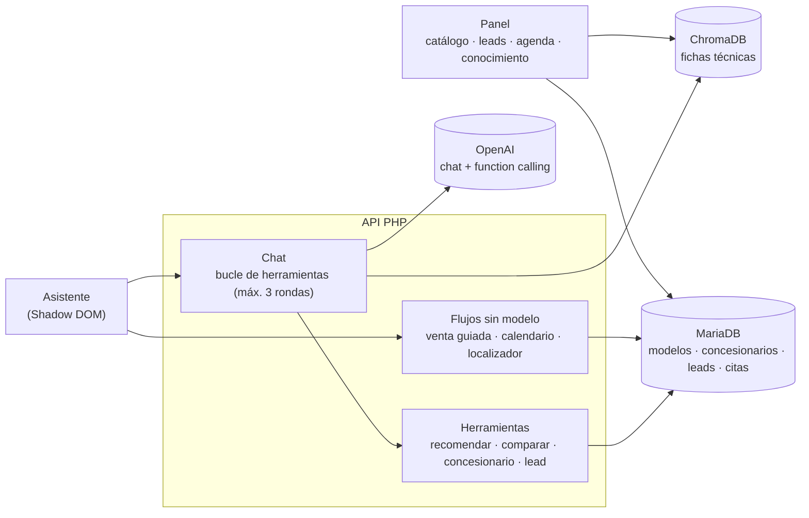

# Caso de estudio: asistente de ventas de autos con RAG y function calling

> **Caso de estudio de un prototipo.** Lo desarrollé en TEDE Consultores para ofrecerlo a una
> empresa de autos. La venta no se concretó y quedó como un agente de ventas más. Los precios
> aparecen como «POR CONFIRMAR» porque no estaban capturados. El código es privado; aquí se
> documentan la arquitectura y las decisiones, con fragmentos genéricos que se pueden ejecutar en
> [`fragmentos/`](fragmentos/).

## Resumen

Un asistente que se integra en el sitio de una agencia de autos con una línea `<script>` y hace dos
trabajos distintos:

- **Conversar** sobre el producto (tecnología, seguridad, versiones) con RAG sobre fichas técnicas.
- **Operar** con datos exactos mediante **function calling**: recomendar modelos, comparar
  versiones, encontrar el concesionario más cercano, agendar la prueba de manejo y registrar el lead.

## El problema

Un asistente de ventas que deja al modelo de lenguaje manejar cifras y fechas se equivoca de
formas caras: inventa precios, recomienda versiones que no existen o agenda una prueba de manejo
«el miércoles 15» que en realidad cae en domingo. La regla del proyecto fue: **donde hay cifras,
fechas o catálogo, decide el código; el modelo conversa y elige qué herramienta usar.**

## Arquitectura

## Decisiones técnicas y por qué

- **Function calling con herramientas en PHP.** El modelo recibe la lista de herramientas con su
  esquema JSON; cuando pide una, PHP la ejecuta contra la base de datos y le devuelve el resultado.
  El bucle se corta a las 3 rondas.
- **Las tarjetas se acumulan entre llamadas,** sin repetir y con tope: «compara A contra B» llama
  dos veces a la misma herramienta y debe mostrar las dos tarjetas, no solo la última.
- **Flujos deterministas que no pasan por el modelo:** la venta guiada en cuatro pasos, el
  calendario de la prueba de manejo y el localizador de concesionarios. La persona **elige**
  opciones en vez de escribir fechas.
- **Toda cita se valida en código:** fecha real y futura, sin domingos, dentro del horario y en la
  zona horaria del negocio. Los mensajes de error están escritos para que el propio asistente los
  use al pedir otra fecha.
- **Sin precio no hay cifra:** un precio no capturado se muestra como «POR CONFIRMAR»; el
  presupuesto mueve el puntaje, pero un modelo sin precio queda neutral en vez de descartarse.
- **Guardarraíl de ámbito:** solo habla del catálogo, resiste instrucciones para salirse del tema y
  no revela su prompt.
- **Privacidad:** de las conversaciones solo se guarda un contador diario y el texto de las
  preguntas sin respuesta, con la IP hasheada.

## Retos que resolví

| Reto | Cómo se resolvió |
|---|---|
| El modelo convertía «miércoles 15» en un domingo | Formulario dentro del chat con opciones y validación en código ([fragmento](fragmentos/validar-cita.php)) |
| Una comparación de dos modelos mostraba solo la última tarjeta | Acumulación de tarjetas entre llamadas a herramientas ([fragmento](fragmentos/bucle-de-herramientas.php)) |
| Recomendaciones que cambiaban según cómo se redactara la pregunta | Venta guiada determinista, reutilizada como herramienta ([fragmento](fragmentos/venta-guiada.php)) |
| Los precios no estaban capturados | «POR CONFIRMAR» explícito; el catálogo nunca inventa una cifra |
| El asistente se integra en un sitio ajeno | Shadow DOM y rutas absolutas derivadas del propio despliegue |

## Resultados

- Prototipo funcional publicado como página de prueba, en julio de 2026.
- Catálogo de 17 versiones de 5 modelos y una red de concesionarios con coordenadas.
- Panel con catálogo, concesionarios, bandeja de leads exportable a CSV, agenda de pruebas de manejo
  y base de conocimiento.

## Stack

| Capa | Tecnología |
|---|---|
| Asistente | JavaScript sin frameworks, Shadow DOM |
| Backend | PHP 8 sin framework ni Composer |
| IA | OpenAI `gpt-4o-mini` con function calling y `text-embedding-3-small` |
| Búsqueda semántica | ChromaDB v2 |
| Datos | MariaDB: modelos, concesionarios, leads, citas |
| Infraestructura | Hosting compartido Apache / LiteSpeed |

## Fragmentos de código

Reescrituras genéricas con un catálogo ficticio. Todas se ejecutan solas, sin clave de API.

| Archivo | Técnica | Ejecutar |
|---|---|---|
| [`bucle-de-herramientas.php`](fragmentos/bucle-de-herramientas.php) | Bucle de function calling con herramientas en PHP y tarjetas acumuladas (con un modelo guionizado) | `php bucle-de-herramientas.php` |
| [`validar-cita.php`](fragmentos/validar-cita.php) | Validación de fecha y hora en código | `php validar-cita.php` (8 comprobaciones) |
| [`venta-guiada.php`](fragmentos/venta-guiada.php) | Recomendación determinista por plazas, uso, presupuesto y prioridad | `php venta-guiada.php` |

## Mi rol

Prototipo que hice en **TEDE Consultores** en julio de 2026, a partir del asistente que había
construido para una arrendadora.

- Agregué a esa base el «músculo» transaccional: function calling sobre MariaDB, venta guiada,
  agenda de pruebas de manejo y localizador de concesionarios.
- Programé el panel: catálogo, concesionarios, leads, agenda y conocimiento.
- Lo publiqué como página de prueba en hosting compartido.

---

## English summary

**Case study: a car-sales assistant prototype with RAG and function calling**, built at TEDE
Consultores to offer to a car company. The sale didn't go through, so it stayed a sales agent
prototype. The model converses and picks tools; PHP executes them against MariaDB (recommend models, compare trims, find dealers,
register leads). Guided selling, the test-drive calendar and dealer lookup are deterministic, and
every appointment is validated in code. Prices that were not provided show as "POR CONFIRMAR"
instead of invented figures. Generic, runnable samples in `fragmentos/`. Stack: PHP 8, MariaDB,
ChromaDB, OpenAI, vanilla JS in a Shadow DOM.
